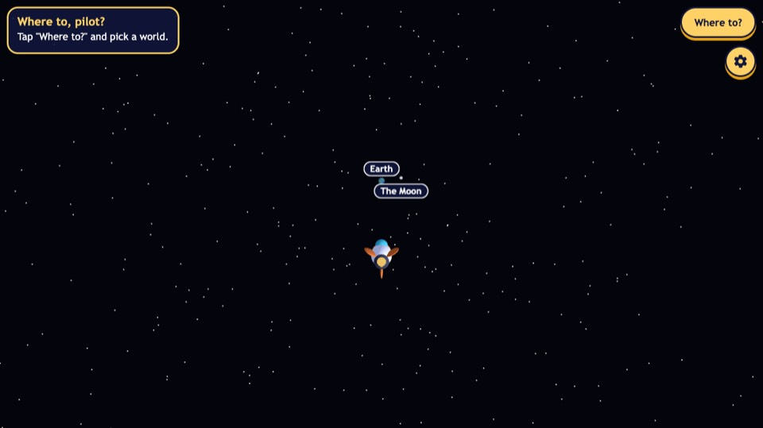
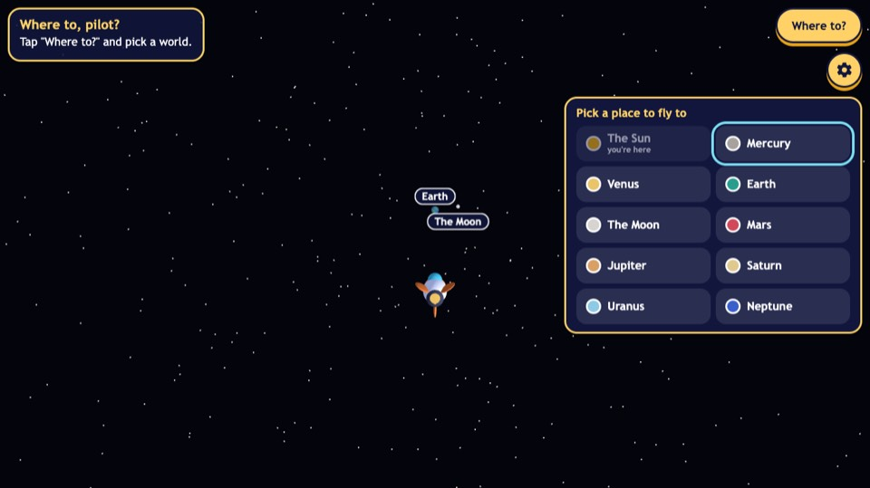
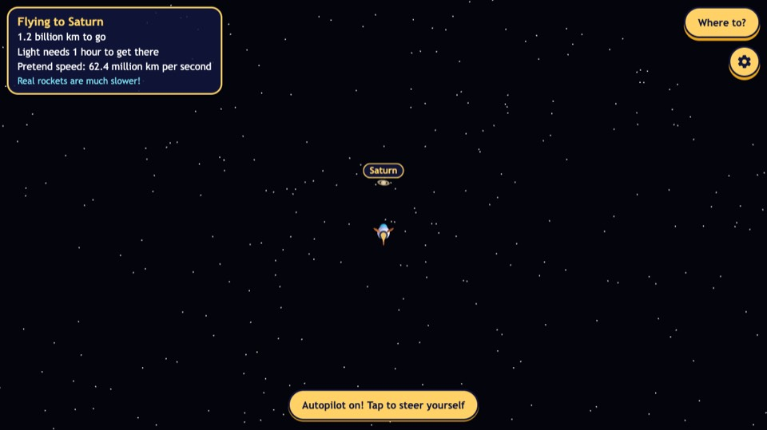
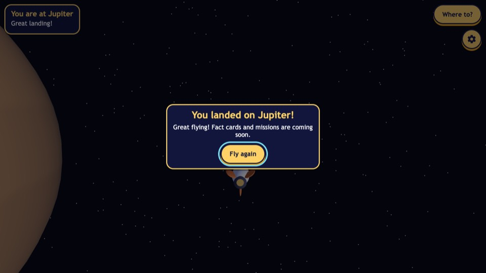
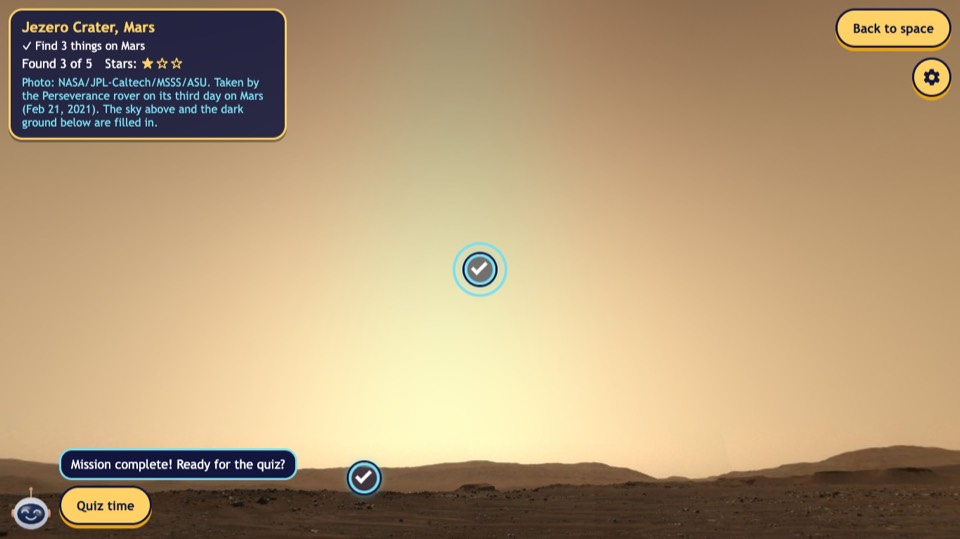
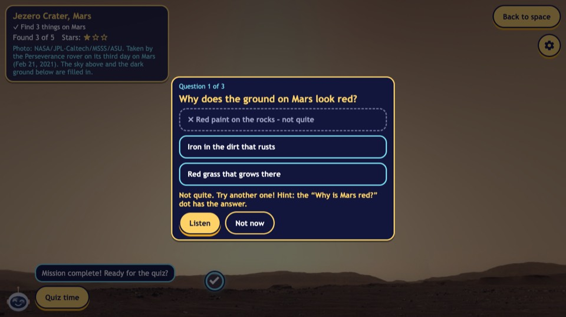
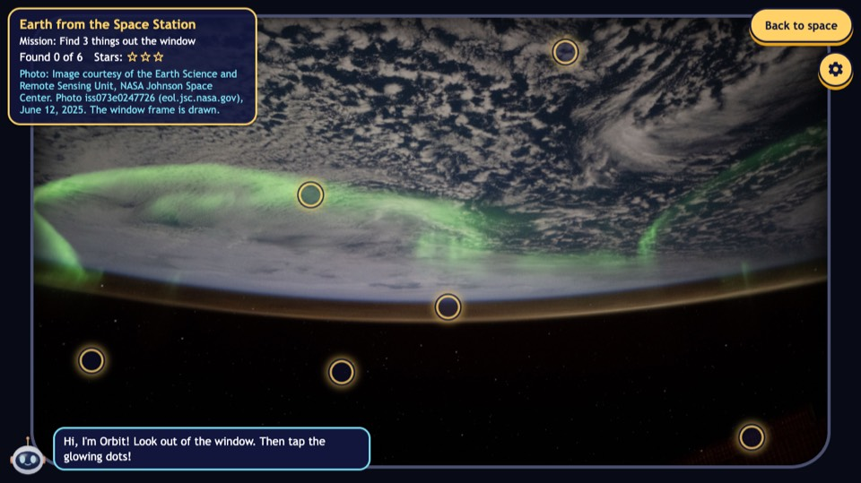
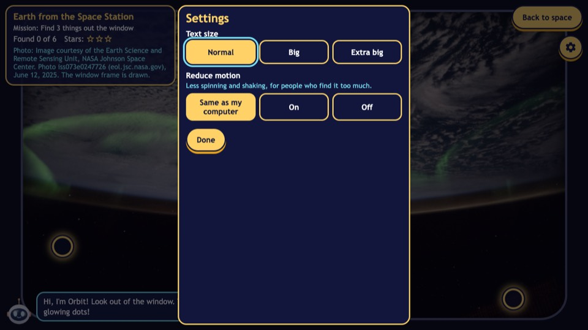

# Rocket Pals: visual design system

**Status: proposal for the product owner's review (2026-11-11).** No application code has changed. Once approved, #21 (mission-control UI) and #22 (Three.js scenes) build it, screen by screen, behind the foundations in #30, #31 and #32.

It designs the screens in [GAME_DESIGN.md](GAME_DESIGN.md) (approved 2026-11-11). The accessibility and performance rules in `CLAUDE.md` come first: a look that breaks them does not ship.

**Contents:** 1. Today's design · 2. Direction and principles · 3. What Three.js draws and what HTML draws · 4. Design tokens · 5. Quality and motion modes · 6. Components · 7. Screens (welcome, space, cockpit HUD, Star Map, landing, mission board, garage, astronaut, journal, achievements and rewards) · 8. Motion · 9. Holographic effects · 10. Accessibility · 11. Performance budget · 12. How it gets built · 13. Decisions for review

---

## 1. Today's design (screenshots, 2026-11-11)

Taken from the current `dev` build in headless Chromium at 1366 x 768 (a common Chromebook size), 390 x 844 (phone) and 844 x 390 (phone, landscape). They are in [`docs/visual-baseline/`](visual-baseline/).

| | |
| --- | --- |
|  |  |
|  |  |
|  |  |
|  |  |

**What works and stays**
* High contrast everywhere: white and gold on deep navy.
* Big targets, short words, a visible focus ring.
* "Not quite" uses a word, a cross and a dashed outline, not colour alone.
* The NASA photos are the most beautiful thing in the game, and the UI mostly stays out of their way.
* The Earth window frame is a strong idea that the fly-by views can reuse.

**What makes it feel like a website, not a game**
1. **Space is empty.** At the start, Earth and the Moon are 6 px dots under their labels, and the rest of the screen is flat black with same-size white points. There is nothing to look at while flying (`03-flying`).
2. **One yellow does every job.** Main buttons, secondary buttons, every border, every title, the stars and the gear button are all the same gold. Nothing stands out, because everything does.
3. **One card for everything.** The HUD, picker, fact card, quiz, landed card and settings are all the same navy rectangle with a 3 px gold border. It looks like a dashboard of boxes.
4. **The world picker is a form.** Ten equal buttons with a coloured dot: no picture of the world, no order in space, no stars, no sense of a journey (`02-picker`).
5. **The flight HUD is a paragraph.** Four lines of text in a box, and the most important number (distance to go) looks the same as the rest.
6. **The landing card is a dead end** and says "landed" on Jupiter (`04-landed-card`). The planet is a flat brown edge on the left.
7. **The photo credit competes with the mission.** Four lines of credit sit inside the mission card, in the same accent colour as the mission text (`07-mission-done`, `10-earth`).
8. **Orbit is tiny.** A 40 px icon in the corner, though Orbit is the main character.
9. **The settings panel stretches** to the full screen height, with an empty half below **Done** (`11-settings`). This is a layout bug.
10. **No type identity.** The font is the computer's own (`Trebuchet MS` or whatever stands in for it), so it looks different on every device.
11. **No motion.** Panels appear instantly, stars do not celebrate, and nothing tells you an action worked except the change itself.
12. **Touch controls are flat circles** (`phone-landscape-01-start`), with a bright orange BOOST that is the loudest thing on the screen.

## 2. Direction and principles

**Direction:** a premium mission control, built for a young pilot. Deep space, cinematic light, frosted-glass instruments with a faint holographic edge, rich planet colours, rounded and friendly shapes, calm motion. It should feel like the cockpit of a spaceship that is also a little bit a toy.

**Principles**
1. **The universe is the hero.** The 3D scene and the NASA photos fill the screen. UI frames them from the edges and never covers the middle for long.
2. **One colour, one meaning.** Gold means "do this". Cyan means "information and focus". Each world's own colour means "this world". Mint means "done". Coral means "not quite".
3. **Glass that stays readable.** Every panel with text is frosted dark enough to pass contrast over the brightest photo (section 4.1). Glass is depth, not transparency for its own sake.
4. **Calm motion with a purpose.** Everything that moves explains something: where a panel came from, that a reward landed, where to look. Nothing loops for decoration on screens where kids read.
5. **Same parts everywhere.** Every screen is built from the components in section 6, so the game feels like one place and is cheaper to build and test.
6. **Kid-sized.** Big targets, big type, short labels, one main action per screen.

## 3. What Three.js draws and what HTML draws

The game has no UI framework: `src/ui/` builds HTML with plain TypeScript and styles it with CSS. That stays. No new framework or CSS library.

| Three.js (WebGL canvas) | HTML and CSS (overlay) |
| --- | --- |
| Space: star field, nebula backdrop, Sun, planets, atmospheres, rings, the asteroid belt | All text, buttons, panels, menus, cards, dialogs |
| The rocket: model, paint, decals, exhaust, trails | The cockpit HUD instruments and the stopwatch |
| In-world markers: target reticle, capsules, crystals, gates, asteroids | World name tags (HTML positioned over the 3D point, as today) |
| Camera moves: arrival, take-off, the welcome drift | Star Map (an HTML orrery with planet thumbnails), Mission Control, the Journal, the patch board |
| The garage and astronaut turntables (a separate scene drawn by the same renderer) | Hotspot dots on photos (as today) |
| The landing photos and fly-by views (as today) | Focus, screen-reader text, keyboard handling |

**Rules**
* Anything a child reads or presses is HTML, so text size, read-aloud, focus and screen readers keep working.
* One WebGL renderer for everything (as today). The garage turntable is a second scene drawn by the same renderer while the Hangar is open; space is not drawn behind it.
* Planet thumbnails for the Star Map and the Journal are small pre-rendered images (WebP, about 10 KB each), made by a script from the same textures the 3D scene uses. They are not a second 3D view.
* The screen manager (#32) runs transitions: the 3D camera move and the HTML transition start together and finish together.

## 4. Design tokens

All tokens are CSS custom properties in one file (`src/ui/styles/tokens.css`). Components use only tokens, never raw values. Three.js reads the colour tokens it needs from a matching TypeScript file (`src/ui/tokens.ts`), so the 3D and the HTML use the same colours.

### 4.1 Colour

**Space (backgrounds)**

| Token | Value | Use |
| --- | --- | --- |
| `--space-950` | `#05060F` | Page behind the canvas |
| `--space-900` | `#0B1030` | Glass base colour, deep panels |
| `--space-800` | `#141B47` | Raised tiles inside panels |
| `--space-700` | `#1F2862` | Hover and selected tile fill |
| `--nebula-violet` | `#3B2A7A` | Backdrop gradient (3D and the welcome screen) |
| `--nebula-teal` | `#0F4C5C` | Backdrop gradient |

**Glass (panels)**

| Token | Value | Use |
| --- | --- | --- |
| `--glass-fill` | `rgba(11, 16, 48, 0.75)` | Every panel that has text |
| `--glass-fill-strong` | `rgba(11, 16, 48, 0.86)` | Dialogs over photos; every panel on low quality |
| `--glass-fill-light` | `rgba(11, 16, 48, 0.55)` | Icon-only controls (no text) |
| `--glass-edge` | `rgba(255, 255, 255, 0.16)` | 1 px border |
| `--glass-highlight` | `linear-gradient(180deg, rgba(255,255,255,0.10), rgba(255,255,255,0) 40%)` | Top sheen inside panels |
| `--glass-blur` | `16px` (high quality), `0` (low quality) | `backdrop-filter` |
| `--scrim` | `rgba(5, 6, 15, 0.55)` | Behind dialogs and sheets |

**Why 0.75:** text on a panel must pass WCAG AA even when the panel sits over the brightest thing in the game (a white cloud, the Mars sky). Over pure white, a 0.75 panel gives white text 8.4:1, gold 5.8:1, cyan 5.5:1 and soft text 5.6:1. At 0.55 white text drops to 4.1:1, which fails. Measured, not guessed.

**Text**

| Token | Value | Contrast on `--glass-fill` (worst case: over white) |
| --- | --- | --- |
| `--text-primary` | `#FFFFFF` | 8.4:1 |
| `--text-soft` | `#C9D2F2` | 5.6:1 (secondary lines, sources) |
| `--text-on-accent` | `#12163D` | 12.1:1 on gold, 11.3:1 on cyan |

There is no grey "muted" text on glass; secondary text is `--text-soft`.

**Meaning (accents)**

| Token | Value | Means | Always paired with |
| --- | --- | --- | --- |
| `--signal-gold` | `#FFD166` | The main action. One per screen | A button shape |
| `--signal-gold-deep` | `#E8A317` | Pressed edge of gold buttons | |
| `--holo-cyan` | `#7BDFF2` | Information, focus, holographic edges, "you are here" | |
| `--holo-violet` | `#A78BFA` | The second holographic tone (gradients only) | |
| `--done-mint` | `#6EF0B5` | Done, found, earned | A tick |
| `--retry-coral` | `#FF9E7A` | "Not quite" (never "wrong" red) | A cross and the words |
| `--star-gold` | `#FFC93C` | Stars | A star shape and a number |

**World colours.** Each world has one colour, used for its ring on the Star Map, its accent line in its panels, its patch and its Journal section. It is always next to the world's name and picture, never on its own.

| World | Token | Value |
| --- | --- | --- |
| Sun | `--world-sun` | `#FFB547` |
| Mercury | `--world-mercury` | `#B8AFA6` |
| Venus | `--world-venus` | `#E9C46A` |
| Earth | `--world-earth` | `#4FA3E0` |
| Moon | `--world-moon` | `#D4D6E0` |
| Mars | `--world-mars` | `#E2673F` |
| Asteroid belt | `--world-belt` | `#A8957E` |
| Jupiter | `--world-jupiter` | `#D9A066` |
| Saturn | `--world-saturn` | `#E8D08C` |
| Uranus | `--world-uranus` | `#8FE3E8` |
| Neptune | `--world-neptune` | `#5672F5` |

### 4.2 Typography

Two typefaces, both under the SIL Open Font License, self-hosted in `public/fonts/` (the game sends nothing to other servers, and a browser test checks that). Latin subset, WOFF2, about 90 KB in total, recorded in `CREDITS.md`.

* **Fredoka** (display): rounded, bold, friendly. Titles, the logo, big numbers on reward screens.
* **Lexend** (text and interface): designed for easy reading, with clear letter shapes. Everything else, including HUD numbers with tabular figures (`font-variant-numeric: tabular-nums`) so they do not jitter.

| Token | Size at Normal | Weight | Line height | Use |
| --- | --- | --- | --- | --- |
| `--type-display` | 44 px | Fredoka 600 | 1.1 | Welcome logo, rank-up |
| `--type-title` | 30 px | Fredoka 600 | 1.15 | Screen titles, fact card titles |
| `--type-heading` | 22 px | Lexend 600 | 1.25 | Panel headings, world names |
| `--type-body` | 18 px | Lexend 400 | 1.45 | Facts, Orbit, questions (never smaller) |
| `--type-ui` | 17 px | Lexend 500 | 1.2 | Buttons, tiles, tabs |
| `--type-label` | 13 px | Lexend 600, uppercase, letter-spacing 0.08em | 1.2 | Instrument labels ("DISTANCE"), never a sentence |
| `--type-numeral` | 28 px | Lexend 600, tabular | 1 | HUD numbers, stopwatch |

Every size is multiplied by `--ui-scale` (today's text-size setting: 1, 1.25, 1.5). The 13 px label is the only text under 17 px, and it is always a single word next to a bigger number.

### 4.3 Space, shape, depth

| Group | Tokens |
| --- | --- |
| Spacing (4 px steps) | `--space-1` 4 · `--space-2` 8 · `--space-3` 12 · `--space-4` 16 · `--space-5` 24 · `--space-6` 32 · `--space-7` 48 |
| Edge gutter | `--gutter` 16 px (phones), 24 px (wider than 900 px) |
| Radius | `--radius-chip` 12 · `--radius-card` 20 · `--radius-sheet` 28 · `--radius-pill` 999 |
| Targets | `--target-min` 56 px (as today) · `--target-main` 64 px (the one main button) |
| Shadow | `--shadow-panel` `0 12px 32px rgba(0,0,0,0.45)` · `--glow-gold` `0 0 24px rgba(255,209,102,0.45)` · `--glow-cyan` `0 0 20px rgba(123,223,242,0.40)` |
| Layers | canvas 0 · world tags 10 · HUD 20 · touch controls 30 · sheets 40 · dialogs 50 · toasts 60 |

### 4.4 Motion

| Token | Value | Use |
| --- | --- | --- |
| `--dur-press` | 120 ms | Button press |
| `--dur-quick` | 200 ms | Hover, focus, toggles |
| `--dur-panel` | 320 ms | Panels, sheets, dialogs |
| `--dur-screen` | 480 ms | Screen changes |
| `--dur-celebrate` | 900 ms | Reward moments |
| `--ease-out` | `cubic-bezier(0.2, 0.8, 0.2, 1)` | Things arriving |
| `--ease-in-out` | `cubic-bezier(0.65, 0, 0.35, 1)` | Camera-linked moves |
| `--ease-spring` | `cubic-bezier(0.34, 1.56, 0.64, 1)` | Rewards only (a small overshoot) |

### 4.5 Breakpoints

| Name | When | Reference device |
| --- | --- | --- |
| `compact` | width below 600 px | Phone, portrait (390 x 844) |
| `short` | height below 520 px | Phone, landscape (844 x 390) |
| `medium` | 600-1199 px wide | Tablet, small Chromebook |
| `wide` | 1200 px and up | Chromebook 1366 x 768, laptop |

## 5. Quality and motion modes

The page gets two attributes on `<html>`: `data-quality="high|low"` (new in #31) and `data-reduced-motion="true|false"` (exists today).

| Effect | High | Low | Reduced motion |
| --- | --- | --- | --- |
| Panel blur | 16 px | none, `--glass-fill-strong` | As the quality says |
| Holographic edge shimmer | once on appear | static edge | static edge |
| Scanlines on instruments | 4% opacity | off | static |
| Panel and screen transitions | slide and fade | fade only | fade only (150 ms or less) |
| Reward animations | full | full, simpler | final state, with a fade |
| Hotspot pulse | yes | yes | no |
| 3D: nebula backdrop | textured | gradient | textured, no drift |
| 3D: bloom on the Sun and exhaust | yes (if the Chromebook numbers from #28 allow) | glow sprites, as today | as the quality says |
| 3D: atmospheres | fresnel shells | sprites | as the quality says |
| 3D: camera moves | eased | eased | cut, or a short fade |
| 3D: welcome drift, planet spin | yes | yes | off |

## 6. Components

Every component: built from tokens, at least 56 px tall if it can be pressed, a visible focus ring, works at every text size, and has a name screen readers can read.

| Component | Anatomy | States | Notes |
| --- | --- | --- | --- |
| **Glass panel** | Fill, 1 px edge, top sheen, shadow, radius | `hud` (no shadow), `card`, `sheet` (bottom on phones, side on wide), `dialog` (strong fill, scrim) | The base of every panel |
| **Button: primary** | Gold pill, navy text, 4 px deeper-gold bottom edge, soft gold glow | rest, hover (brighter, glow), pressed (moves down 2 px, edge shrinks), focus, disabled (outline only, never greyed text) | **One per screen.** "Fly!", "Set course", "Quiz time", "Next" |
| **Button: secondary** | Glass pill, cyan 1.5 px edge, white text | as above | "Back to space", "Not now", "Got it" |
| **Button: icon** | Glass circle 56 px, icon, hidden text label | as above | Menu, Listen, close, info |
| **Segmented control** | Glass track, gold thumb that slides | each segment focusable | Settings, Journal tabs, garage slot tabs on phones |
| **Tile** | Raised `--space-800` rectangle, picture, title, small line, optional badge | rest, hover, selected (cyan edge and glow), locked (padlock, condition text), done (mint tick), new (gold dot) | Star Map worlds, answers, garage items, missions, Journal pages |
| **Chip** | Small pill, icon and text | world chip (world-colour dot), status chip ("+20 XP") | Tags in space, rewards on mission tiles |
| **Instrument** | Label (uppercase), big tabular number, unit, optional bar | normal, highlighted (cyan) | Cockpit HUD readouts, the stopwatch |
| **Progress bar** | Track, fill, optional ticks | fills with `--ease-out` | XP bar, distance to go, chapter progress |
| **Star row** | Three stars, filled or outline, plus "2 of 3" for screen readers | fill with a spring | Everywhere stars are shown |
| **Rank badge** | Hexagon, rank number and name, holographic edge | normal, new (shimmer once) | Welcome screen, rewards, Mission Control |
| **Patch** | Round embroidered-style badge in the world or category colour | earned (full colour, date), not yet (outline, condition) | Patch board, astronaut suit |
| **Orbit dock** | Orbit portrait (72 px, 4 moods), glass speech bubble, Listen icon button | idle, talking (bubble grows in), happy | Bottom left on every screen where Orbit speaks |
| **Hotspot** | Cyan ring, soft inner pulse, 56 px hit area | new (pulsing), focused (thick ring), found (mint fill, tick, label chip) | On photos and fly-by views |
| **Dialog** | Strong glass, title in the world colour, body, source line, actions row | opens from the element that opened it | Fact cards, quiz, rewards, confirmations |
| **Toast** | Small glass chip from the top centre, 2.5 s, `aria-live="polite"` | | "+3 XP Capsule fact", "Equipped!" |
| **Touch stick and Boost** | Glass ring with a gold knob; Boost is a 88 px glass circle with a gold flame icon | rest, held (glow), floating stick (appears under the thumb) | Boost no longer orange: gold glow means "press" |
| **Focus ring** | 3 px `--holo-cyan` outline with a 2 px dark gap | | Shows on glass, on photos and on gold buttons |

## 7. Screens

Each screen below gives layout, components, hierarchy (1 is what the eye sees first), colours, type, animation, interaction, and what changes on phones. Sketches are wide (1366 x 768) unless they say otherwise.

### 7.1 Welcome screen

```
┌──────────────────────────────────────────────────────────────┐
│  (3D: slow drift past Earth; the rocket idles, exhaust glows) │
│                                                              │
│                      ROCKET PALS                             │
│                 your trip through space                      │
│                                                              │
│                     [   Fly!   ]                             │
│              [Hangar] [Journal] [Settings]                   │
│                                                              │
│  ⬡ 4 Navigator · Comet Fox · ★ 14        Orbit: "Welcome back!"│
└──────────────────────────────────────────────────────────────┘
```

* **Layout:** full-bleed 3D. The logo and buttons in the centre-left third, over the dark side of the scene. A pilot strip along the bottom for returning players.
* **Components:** logo (Fredoka, gold, cyan holographic edge), primary button, three secondary buttons, rank badge, star row total, Orbit dock.
* **Hierarchy:** 1 the scene, 2 the logo, 3 **Fly!**, 4 the pilot strip.
* **Colours:** nebula gradient (violet to teal) behind Earth; gold only on **Fly!** and the logo.
* **Type:** logo `--type-display` 64 px; subtitle `--type-heading` in `--text-soft`.
* **Animation:** the logo rises 12 px and fades in (480 ms), then the buttons follow (80 ms apart). **Fly!** breathes a soft glow every 3 s (off with reduced motion). Pressing **Fly!**: the camera swings behind the rocket while the UI fades (one 900 ms move into the space screen).
* **Interaction:** Enter or Space presses **Fly!** (it has focus). First time only: a sheet offers three call signs, a "More names" button and three rocket colours, then First flight.
* **Phone:** logo at the top third, buttons stacked at the bottom in thumb reach (**Fly!** full width), pilot strip above them. Landscape: logo left, buttons right.

### 7.2 Main space exploration screen (no destination)

```
┌──────────────────────────────────────────────────────────────┐
│ [● NEXT: Visit Earth  ★ 0/3]                    [Star Map] (≡)│
│                                                              │
│                 ( Earth ★★☆ )                                │
│                       ●     ( The Moon )                     │
│                                                              │
│                          ▲  rocket                           │
│                                                              │
│  (stick)                    "Pick a place on the Star Map"  (BOOST)│
└──────────────────────────────────────────────────────────────┘
```

* **Layout:** the scene fills the screen. Top left: the Grand Tour chip (what to do next). Top right: **Star Map** (primary) and the menu icon button (Mission Control). Today's gear button moves into Mission Control > Settings, so the top right has one big action and one icon.
* **Components:** chip, primary button, icon button, world chips over the 3D, toast hint, touch stick and Boost.
* **Hierarchy:** 1 the rocket and the nearest worlds, 2 **Star Map**, 3 the Grand Tour chip.
* **Colours:** world chips carry a world-colour dot and the stars; the hint is a cyan-edged toast.
* **3D (#22):** a nebula backdrop with depth, stars in three sizes and two brightnesses, planets with real textures and an atmosphere rim, the Sun with bloom, Saturn's banded ring, and a soft exhaust trail. Worlds are lit from the Sun with a gentle fill, so their night sides are dark blue, not black.
* **Animation:** world chips fade in when a world comes within range. The hint toast appears after 6 s with no input and leaves on the first input.
* **Interaction:** M opens the Star Map, Escape opens Mission Control. Keyboard and stick fly as today. Mouse and touchpad: drag anywhere on empty space to steer (#24).
* **Phone:** the chip shrinks to "NEXT ▸ Earth". The stick floats under the thumb anywhere in the left half, and Boost sits bottom right, both in thumb reach.

### 7.3 Rocket cockpit HUD (flying to a destination)

```
┌╭─────────────────────────────────────────────────────────────╮┐
│ DISTANCE TO GO        ◉ SATURN  ━━━━━━━━━░░░░  62%    CAPSULES │
│ 1.2 billion km                                          2 / 3  │
│ LIGHT TAKES 1 h                ⌖ (reticle on Saturn)          │
│                                                               │
│                            ▲                                  │
│ SPEED                                              ◂ (arrow if  │
│ pretend: 62 million km/s                              off-screen)│
│ Cassini took 7 years              [Autopilot ●  on]            │
╰─────────────────────────────────────────────────────────────╯
```

* **Layout:** thin holographic corner brackets frame the screen (CSS, decorative, ignore the mouse). Top centre: the destination strip (world thumbnail, name, distance bar). Left: two instruments (distance, light time). Lower left: speed with the honest comparison. Top right: capsules. Bottom centre: the autopilot switch.
* **Components:** instrument, progress bar, chip, segmented switch, the 3D reticle and edge arrow.
* **Hierarchy:** 1 the scene and the reticle on the destination, 2 the destination strip, 3 distance to go (the biggest number), 4 everything else.
* **Colours:** instruments are glass with a 4% scanline texture and cyan labels. The distance bar is in the destination's world colour. The reticle and edge arrow are holo cyan.
* **Type:** labels `--type-label`, numbers `--type-numeral` (tabular), the speed note `--type-body` in `--text-soft`.
* **Animation:** numbers change in place (tabular, no jitter). Picking up a capsule sends a "+3" chip from the capsule's screen point to the capsule counter (400 ms). On arrival the HUD fades and the camera eases into the arrival view (900 ms).
* **Challenge mode:** the destination strip becomes the stopwatch (count-up, best time beside it), and capsules become crystals. Bumps show a soft cyan ripple at the screen edge on the bump side (no red, no shake).
* **Interaction:** the instruments are not buttons. The autopilot switch takes Enter and Space, and steering turns autopilot off, as today.
* **Phone portrait:** one top strip with the destination, the distance and capsules; tap the strip to show the other instruments for 4 s. Landscape (`short`): the instruments shrink to the left edge and the corner brackets are hidden.

### 7.4 Planet navigation: the Star Map

```
┌──────────────────────────────────────────────────────────────┐
│ STAR MAP                         [ ] Show real distances    (×) │
│                                                               │
│  ☀ ── ● ── ● ── ◉ ─ · ── ● ── ░░░ ── ◯ ──── ◯ ──── ◯ ──── ◯     │
│ Sun  Merc Venus Earth Moon Mars belt Jupiter Saturn Uranus Neptune│
│      ★☆☆  ☆☆☆  ★★★ 📍   ★★☆  NEXT   ☆☆☆    ☆☆☆                │
│                                        ┌────────────────────┐ │
│                                        │ ◯ JUPITER          │ │
│                                        │ The biggest planet │ │
│                                        │ 778 million km from│ │
│                                        │ the Sun · light 43m│ │
│                                        │ Fly-by · ★☆☆       │ │
│                                        │ [  Set course  ]   │ │
│                                        └────────────────────┘ │
└──────────────────────────────────────────────────────────────┘
```

* **Layout:** a sheet over the dimmed, still-moving space scene. One curved track from the Sun outwards, with each world as a node (planet thumbnail, name, stars). The asteroid belt is a dotted band. Choosing a node opens a detail panel on the right.
* **Components:** glass sheet, tiles as nodes, star rows, chips ("NEXT", "You are here" pin), detail dialog, primary **Set course**, toggle.
* **Hierarchy:** 1 the track of worlds, 2 the Grand Tour "NEXT" glow, 3 the selected world's panel, 4 **Set course**.
* **Colours:** each node has a ring in its world colour. The next Grand Tour step glows gold; "You are here" is a cyan pin. The detail panel has a world-colour accent line at the top.
* **Type:** node names `--type-ui`; the detail title `--type-title`; facts `--type-body`.
* **Sizes:** nodes are sized by planet type (small rocky, large giants), not to scale; the panel says so. **Show real distances** re-spaces the track to true relative distances (the inner worlds bunch up near the Sun) with a 600 ms ease, and back.
* **Animation:** the sheet rises from the **Star Map** button (320 ms). Nodes appear in order from the Sun (40 ms apart) the first time each session. **Set course** closes the map, and the reticle appears on the world in 3D.
* **Interaction:** Left and Right move along the track, Enter opens the panel, Escape closes it. Tapping a node selects it, and a second tap or **Set course** confirms. Screen readers get an ordered list ("Jupiter, 5th of 11, 1 star of 3").
* **Phone portrait:** the track runs top to bottom (Sun at the top) and scrolls, and the detail panel is a bottom sheet. Landscape: a horizontal track that scrolls with snap points.

### 7.5 Planet landing (and fly-by)

```
┌──────────────────────────────────────────────────────────────┐
│ [▍JEZERO CRATER, MARS                ]           [Back to space] (≡)│
│ [ Find 3 things   ● ● ○               ]                       │
│                                                               │
│            ◎ (new dot)                  ✓ Rover (found)       │
│                                                               │
│      (full-bleed NASA photo, drag to look)                    │
│                                                               │
│ (Orbit)  "Two found! One more to discover."  (🔊)              │
│                                               Photo: NASA/JPL ⓘ│
└──────────────────────────────────────────────────────────────┘
```

* **Layout:** the photo fills the screen. Top left: the location card (world-colour accent bar, place name, mission with progress pips, stars once earned). Top right: **Back to space** (secondary) and the menu. Bottom left: the Orbit dock. Bottom right: a one-line credit with an info button. The full credit (today's four lines) opens in a small dialog.
* **Fly-by view:** the photo is seen through a rounded cockpit window with two struts and a faint reflection. The title says "Flying past Jupiter".
* **Components:** glass card, progress pips, hotspots, Orbit dock, secondary and icon buttons, dialog (fact card, quiz, credit).
* **Hierarchy:** 1 the photo, 2 the dots, 3 the mission line, 4 Orbit.
* **Colours:** hotspots are holo cyan (they read on both red Mars and blue Earth); found dots turn mint with a tick. The fact card title is in the world colour; the source line is `--text-soft`.
* **Fact card and quiz:** the same dialog component. Answers are tiles: rest (glass with cyan edge), not quite (coral dashed edge, cross and words, as today), right (mint edge, tick, then the "because" line). The quiz step shows as pips ("Question 2 of 3" for screen readers).
* **Animation:** arrival is the camera easing in, then the photo fading up through the world colour (480 ms). There is no white flash. The card grows from the dot that was tapped (320 ms). Finding the last mission dot: Orbit turns happy, the pips fill with a spring, and **Quiz time** slides up beside Orbit as the main button with a gold glow.
* **Interaction:** drag or arrow keys to look (as today), Tab to go between dots (as today), Escape closes a card. Listen is the first button in every card.
* **Phone portrait:** the location card shrinks to two lines. Cards are bottom sheets, with the photo still visible above. Orbit's bubble sits above the dock and never covers the sheet. The credit line stays visible as one line.

### 7.6 Mission board (Mission Control > Missions)

```
┌──────────────────────────────────────────────────────────────┐
│ MISSION CONTROL  [Missions] [Hangar] [Journal] [Patches] [⚙]  (×)│
├────────────────┬─────────────────────────────────────────────┤
│ GRAND TOUR     │  CHAPTER 2 · ROCKY WORLDS        ━━━━░░ 2/4   │
│ ✓ 1 Home       │  (banner: Mercury, Venus, Mars, the Sun)     │
│ ▸ 2 Rocky      │  ✓ Visit Mercury             +20 XP ★        │
│   3 Belt       │  ✓ Visit Venus               +20 XP ★        │
│   4 Ice giants │  ▸ Land on Mars              +20 XP [ Go ]   │
│                │    Look at the Sun safely    +20 XP [ Go ]   │
│ ORBIT ASKS     │  ───────────────────────────────────────     │
│ 2 requests     │  ORBIT'S REQUESTS                            │
│ RESCUES        │  ◻ Collect a capsule on the way to Venus [Go]│
└────────────────┴─────────────────────────────────────────────┘
```

* **Layout:** Mission Control is one big glass sheet with five tabs along the top; the game pauses behind it. Missions: chapters on the left, the open chapter on the right, side missions below it.
* **Components:** tabs, tiles (mission steps), progress bars, chips (rewards), primary **Go** on the next step only (others have secondary **Go**).
* **Hierarchy:** 1 the open chapter and its next step, 2 the rewards on each step, 3 side missions.
* **Colours:** the chapter banner uses its worlds' colours. Done steps have a mint tick, the next step a gold edge, and the rest are plain.
* **Type:** chapter title `--type-title`; step names `--type-ui`; reward chips `--type-label`.
* **Animation:** the sheet scales from 0.98 and fades in (320 ms). A step finished since the last visit ticks itself (spring) when the board opens.
* **Interaction:** **Go** sets course and closes Mission Control, straight into flying with the reticle set. Up and Down move between steps.
* **Phone:** the tabs become a scrollable row, and the chapter list becomes a segmented control above the steps.

### 7.7 Customization garage (Mission Control > Hangar > Rocket)

```
┌──────────────────────────────────────────────────────────────┐
│ HANGAR   [Rocket] [Astronaut]                                (×)│
├───────────┬──────────────────────────────┬───────────────────┤
│ ◉ Paint   │                              │  PAINT            │
│ ◯ Decals  │   (3D turntable: the rocket  │  ■ ■ ■ ■          │
│ ◯ Exhaust │    on a glowing pad, studio  │  ■ ✓ ■ 🔒          │
│ ◯ Gear    │    light, holographic grid)  │  🔒 Reach Navigator│
│           │   drag to turn               │  "Mars red: Mars  │
│           │                              │   is red because  │
│           │                              │   of rusty dust." │
└───────────┴──────────────────────────────┴───────────────────┘
```

* **Layout:** three columns: slot tabs on the left, the 3D rocket in the middle (the largest area), the item grid and the selected item's fact on the right.
* **Components:** vertical tabs, tiles (swatches and decals), chips ("New"), a toast ("Equipped!"), and the 3D turntable (Three.js hangar scene: a soft key light, a rim light, a glowing floor ring and a faint cyan grid).
* **Hierarchy:** 1 the rocket, 2 the selected item, 3 the grid, 4 locked conditions.
* **Colours:** the hangar is the darkest screen, so the rocket's colours pop. The equipped item has a mint tick; locked items are dimmed with a padlock and their condition in `--text-soft`.
* **Type:** item names `--type-ui`; facts `--type-body`; conditions `--type-ui`.
* **Animation:** choosing a paint sweeps the new colour across the trim (300 ms shader wipe; an instant swap with reduced motion). New unlocks shimmer once. The turntable turns slowly by itself (off with reduced motion) and follows drag.
* **Interaction:** **tapping an item equips it straight away** (no separate Equip step); tapping again does nothing, and the previous choice is one tap away. A locked item opens its condition card with **Show me how**, which opens the mission or Star Map entry that unlocks it. Arrow keys move in the grid; Q and E or a drag turn the rocket.
* **Phone portrait:** the rocket in the top half, the slot tabs as a chip row, and the grid as a bottom sheet. Landscape: the rocket on the left, the grid on the right.

### 7.8 Astronaut customization (Hangar > Astronaut, Phase 2)

The same layout and components as the garage, so it costs little to build once the astronaut model exists.
* **Turntable:** the astronaut in an idle wave on the same pad.
* **Slots:** Suit, Visor, Patch, Backpack, Helmet light.
* **Call sign card** above the slots: the call sign, the rank badge, and **Change name** (opens the same list of names as the first-time sheet).
* **Patch slot:** shows only earned patches. Choosing one zooms the camera onto the chest for a moment (a cut with reduced motion).
* **Colours:** the visor shows a reflection of the nebula. Suit colours are the softer world colours (no neon).
* **Phone:** as the garage.

### 7.9 Discovery journal (Mission Control > Journal)

```
┌──────────────────────────────────────────────────────────────┐
│ JOURNAL   [Worlds] [On the way] [Explorers]                  (×)│
├───────────────┬──────────────────────────────────────────────┤
│ ◉ Earth  6/6 ✓│  MARS · 3 of 5 pages                  ━━━░░  │
│ ◉ Moon   3/3 ✓│  ┌──────┐ ┌──────┐ ┌──────┐ ┌──────┐ ┌──────┐ │
│ ◉ Mars   3/5  │  │photo │ │photo │ │photo │ │  ?   │ │  ?   │ │
│ ◯ Jupiter 0/3 │  │crop  │ │crop  │ │crop  │ │ near │ │ in   │ │
│ ...           │  │Rim   │ │Rover │ │Ground│ │ the  │ │ the  │ │
│               │  └──────┘ └──────┘ └──────┘ │ sky  │ │ photo│ │
│               │                             └──────┘ └──────┘ │
└───────────────┴──────────────────────────────────────────────┘
```

* **Layout:** worlds on the left with a completion ring each; the open world's pages as a grid on the right. Tabs: Worlds, On the way (capsule facts), Explorers (spacecraft cards, Phase 2).
* **Components:** tabs, tiles (pages), progress rings and bar, dialog (a page opens as the same fact card, with Listen).
* **Hierarchy:** 1 the open world's pages, 2 the empty outlines (where to go next), 3 the world list.
* **Colours:** each world section has its world colour on its ring and header. Found pages show a small crop of the photo around their dot (pre-made images, about 8 KB each). Pages not yet found are outlined, with a short hint ("in the sky", "near the rover").
* **Type:** page titles `--type-ui`; hints `--type-ui` in `--text-soft`.
* **Animation:** pages earned since the last visit flip in one by one (spring, 120 ms apart). A completed world gets a mint ring and its patch shown once.
* **Interaction:** a page opens the fact card; Listen reads it. A hint tile offers **Take me there** (sets course). Arrow keys move in the grid.
* **Phone:** the world list becomes a horizontal chip row, and pages are a two-column grid.

### 7.10 Achievements and rewards

**Patch board (Mission Control > Patches)**
* **Layout:** a grid of round patches grouped by category (Explorer, Pilot, Scientist, Helper), with a filter row of chips.
* **Look:** earned patches in full colour with a stitched edge and the date earned; not-yet patches as a dim outline with their condition underneath ("Finish the Ace course").
* **Interaction:** a patch opens a small dialog with its fact and, if earned, **Wear it** (opens the astronaut's patch slot, Phase 2).
* **Phone:** a three-column grid, with the categories as chips.

**Reward screen (after a mission, a quiz or a challenge)**

```
┌───────────────────────────────┐
│        MISSION COMPLETE        │
│           ★   ★   ☆            │
│   +40 XP  ━━━━━━━━━━░░  ⬡ 4    │
│   📖 3 new journal pages        │
│   ◉ New patch: Red Planet       │
│   ─────────────────────────    │
│   Orbit: "Jupiter is next!"    │
│   [  Fly to Jupiter  ] [Later] │
└───────────────────────────────┘
```

* **Layout:** a dialog in the centre (a full-height sheet on phones), over the dimmed scene or photo.
* **Order:** the title drops in. Stars fill one at a time (spring, 300 ms each, with a soft chime from #34). The XP bar fills and the number counts up. New Journal pages fly to the Journal icon. A new patch drops in with a stitched-edge shimmer. Last, Orbit's suggestion appears with a primary button for it.
* **Rank-up:** after the XP bar fills, it takes over the dialog: the rank badge grows in with a holographic sweep, the new rank name in `--type-display`, and the list of what it unlocked ("New paint: Nebula Purple") with **Show me** (opens the Hangar).
* **Hierarchy:** 1 stars, 2 XP and rank, 3 new things, 4 what next.
* **Interaction:** tap or press any key to skip to the end. Escape or **Later** closes it.
* **Reduced motion:** the final state appears with a fade; nothing flies.

**Toasts:** small rewards while flying ("+3 XP · Capsule fact") use the toast at the top centre, never a dialog, so play is not interrupted.

## 8. Motion

* **Only transform and opacity animate** (cheap for the browser). No animated blur, size or layout.
* **Screen change:** the old screen fades and scales to 0.98, and the new one fades in from 1.02 (480 ms, `--ease-out`). When the 3D camera moves, the HTML waits for it.
* **Sheets:** slide 24 px and fade (320 ms). **Dialogs:** scale from 0.96 and fade (240 ms), from the element that opened them.
* **Press:** 2 px down, 0.97 scale (120 ms).
* **Rewards:** `--ease-spring`, and only on reward moments.
* **3D:** arrival and take-off camera eases (900 ms, `--ease-in-out`); the garage turntable at 0.15 turns a second.
* **Reduced motion:** everything above becomes a fade of 150 ms or less, or a cut. The pulse, breathing glow, shimmer, drift and turntable stop. No information is lost (section 5).

## 9. Holographic effects

Subtle, for a sense of technology; never on text a child reads.
1. **Holographic edge:** a 1 px gradient border from `--holo-cyan` to `--holo-violet` at 60% on active elements (the selected tile, the rank badge, the focused instrument). Static on low quality.
2. **Scanlines:** a 2 px repeating gradient at 4% opacity, on HUD instruments only. Off on low quality.
3. **Shimmer:** a single diagonal light sweep across new unlocks, rank badges and new patches when they first appear. Never a loop.
4. **In 3D:** the target reticle, capsules and gates use additive cyan sprites with a soft edge (Three.js). Capsules turn slowly (stopped with reduced motion).
5. **Never:** flicker, strobing, glitch effects, or chromatic aberration on text.

## 10. Accessibility

* **Contrast:** every text and background pair passes WCAG AA (4.5:1) in the worst case, as calculated in section 4.1. A unit test checks the token pairs.
* **Focus:** the cyan ring with a dark gap, visible on glass, photos and gold. Order follows the reading order; dialogs trap focus and return it.
* **Never colour alone:** worlds always have a name and a picture, done has a tick, not quite has a cross and words, stars have a number for screen readers.
* **Text size:** every screen works at Normal, Big and Extra big on every breakpoint (the browser tests check for overlaps, as today).
* **Targets:** 56 px minimum, 64 px for the main button, 88 px for Boost on touch.
* **Keyboard:** M Star Map, Escape back or Mission Control, Space boost, Enter confirm, arrows to move in grids and the track.
* **Read-aloud:** every dialog, Orbit bubble and Journal page has Listen (#34).
* **Motion and quality:** section 5. No flashing anywhere.

## 11. Performance budget (for a school Chromebook)

| Item | Budget |
| --- | --- |
| Panels with blur visible at once | 3 or fewer, high quality only. Full-screen sheets (Star Map, Mission Control) use the strong fill and a scrim, never blur, because a full-screen blur over a moving 3D scene is the most expensive case |
| Blur radius | 16 px maximum |
| Fonts | 2 families, Latin subset, WOFF2, about 90 KB in total, `font-display: swap` |
| Planet thumbnails and Journal crops | WebP, about 10 KB each, loaded when the screen first opens |
| CSS animation | transform and opacity only; no `box-shadow` or `filter` animation |
| 3D effects | as section 5, and only what the Chromebook numbers from #28 allow |
| First download | still under 15 MB (today about 0.8 MB) |

## 12. How it gets built (no code yet)

1. **Tokens first, with no visible change:** move today's values into `tokens.css` and use them everywhere (part of #21).
2. **The quality flag** on `<html>` (#31).
3. **Components**, one at a time, each with its own small test page used by the browser tests: panel, buttons, tile, instrument, dialog, toast, Orbit dock.
4. **Screens** in game-design order: cockpit HUD and space screen, landing and fly-by, Star Map, reward screen, Mission Control (missions, Journal, patches), Hangar, welcome screen, astronaut (Phase 2).
5. **3D pass (#22)** alongside: tone mapping, lighting and atmospheres first (cheap), then the nebula and bloom after the Chromebook numbers.
6. **Checks for every screen:** the existing overlap and target-size browser tests at every breakpoint and text size; a token contrast test; screenshots at the four reference sizes added to `docs/visual-baseline/` for review (not pixel-compared in CI, because software WebGL differs between machines).

File layout: `src/ui/styles/tokens.css`, `components.css`, `screens/<screen>.css`, with `src/style.css` importing them; `src/ui/tokens.ts` for the colours Three.js needs; `public/fonts/`.

## 13. Decisions for review

1. **Fonts:** Fredoka for titles and Lexend for everything else, self-hosted (about 90 KB).
2. **Gold means "do this", only.** One gold button per screen; borders and titles stop being gold. This is the biggest visible change.
3. **Glass at 0.75 fill** for anything with text (measured for contrast), and no blur on full-screen sheets.
4. **The Star Map is an HTML orrery** over the live scene (accessible and cheap), not a separate 3D map.
5. **Tapping an item in the Hangar equips it straight away,** with no Equip button.
6. **One menu button replaces the gear.** Settings move into Mission Control.
7. **The photo credit becomes one line with an info button,** and the full credit opens in a dialog. It is still always on screen.
8. **Boost turns from orange to gold-on-glass,** so the loudest thing on screen is no longer a control.
